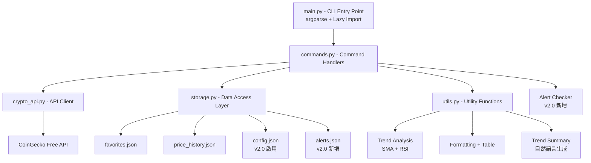
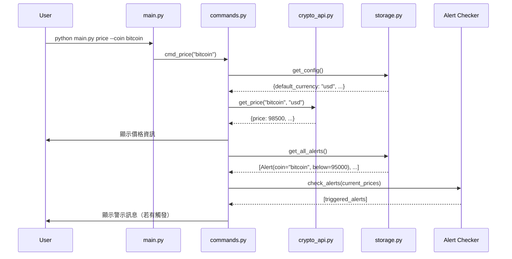
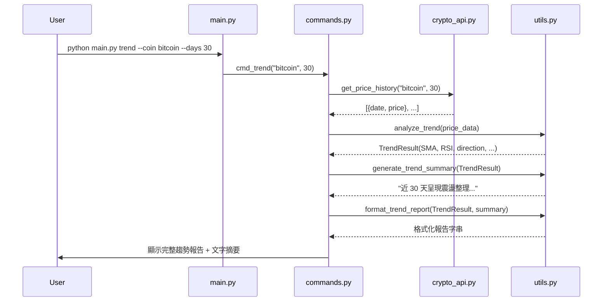

\# CryptoTracker v2.0 — SDD 規格文件

\## 1. 專案概覽（Project Overview）

\- \*\*程式名稱\*\*：CryptoTracker

\- \*\*版本\*\*：v2.0

\- \*\*一句話描述（Elevator Pitch）\*\*：一款具備主動價格警示、多幣種比較與個人化設定的 CLI 加密貨幣追蹤與趨勢分析工具。

\- \*\*目標使用者\*\*：對加密貨幣有興趣的個人投資者、開發者與學習者。

\- \*\*核心價值\*\*：在 v1.0 被動查詢的基礎上，新增主動警示、橫向比較與強化趨勢分析，讓使用者從「手動查詢」進化為「主動感知」的投資追蹤體驗。

\### v2.0 新增功能摘要

| 功能 | 說明 |

|---|---|

| 個人設定檔 | 啟用 `config.json`，支援預設法幣、預設筆數等偏好設定 |

| 價格警示 | 為收藏幣種設定價格閾值，執行任何指令時自動檢查並顯示警示 |

| 多幣種比較 | 一次比較多個幣種的價格、漲跌幅，以對齊表格呈現 |

| 強化趨勢分析 | 新增 RSI 分析維度與自然語言文字摘要 |

\---

\## 2. CLI 介面規格（Interface Specification）

\### `python main.py <command> \[options]`

\#### v1.0 保留指令（完全相容）

| 指令 | 參數 | 說明 | 範例 |

|---|---|---|---|

| `price` | `--coin TEXT` | 查詢指定幣種的即時價格（USD） | `python main.py price --coin bitcoin` |

| `price` | `--coin TEXT --currency TEXT` | 查詢指定幣種的即時價格（指定法幣） | `python main.py price --coin bitcoin --currency twd` |

| `top` | `--num INT` | 列出市值前 N 名的加密貨幣（預設 10） | `python main.py top --num 5` |

| `favorite add` | `--coin TEXT` | 將幣種加入收藏清單 | `python main.py favorite add --coin bitcoin` |

| `favorite remove` | `--coin TEXT` | 將幣種從收藏清單移除 | `python main.py favorite remove --coin bitcoin` |

| `favorite list` | （無） | 列出所有收藏幣種及其即時價格 | `python main.py favorite list` |

| `history` | `--coin TEXT --days INT` | 查詢指定幣種過去 N 天的價格歷史 | `python main.py history --coin bitcoin --days 7` |

| `trend` | `--coin TEXT --days INT` | 對指定幣種進行趨勢分析 | `python main.py trend --coin bitcoin --days 30` |

| `export` | `--coin TEXT --days INT --format TEXT` | 匯出歷史資料為 CSV 或 JSON | `python main.py export --coin bitcoin --days 7 --format csv` |

\#### v2.0 新增指令

| 指令 | 參數 | 說明 | 範例 |

|---|---|---|---|

| `config get` | （無） | 顯示目前所有設定值 | `python main.py config get` |

| `config set` | `--currency TEXT` | 設定預設法幣 | `python main.py config set --currency twd` |

| `config set` | `--top-num INT` | 設定 top 指令的預設筆數 | `python main.py config set --top-num 20` |

| `config reset` | （無） | 重設所有設定為預設值 | `python main.py config reset` |

| `alert add` | `--coin TEXT --above FLOAT` | 新增價格高於閾值的警示 | `python main.py alert add --coin bitcoin --above 100000` |

| `alert add` | `--coin TEXT --below FLOAT` | 新增價格低於閾值的警示 | `python main.py alert add --coin ethereum --below 2000` |

| `alert remove` | `--id INT` | 移除指定 ID 的警示 | `python main.py alert remove --id 1` |

| `alert list` | （無） | 列出所有警示規則 | `python main.py alert list` |

| `compare` | `--coins TEXT --days INT` | 多幣種橫向比較 | `python main.py compare --coins bitcoin,ethereum,solana --days 7` |

\### 全域旗標

| 旗標 | 說明 |

|---|---|

| `--help` | 顯示幫助訊息 |

| `--version` | 顯示版本號 |

\### 設定優先順序

指令列參數 > config.json 設定檔 > 程式內建預設值

---

## 3. 資料模型（Data Model）

### Favorite（v1.0 保留，無變更）

| 欄位 | 型別 | 說明 | 必填 |
|---|---|---|---|
| id | int | 唯一識別碼，自動遞增 | ✅ |
| coin_id | str | 幣種 ID（如 `bitcoin`） | ✅ |
| added_at | str | 加入時間（ISO 8601 格式） | ✅ |
| metadata | dict | 預留擴充欄位 | ❌ |

### PriceRecord（v1.0 保留，無變更）

| 欄位 | 型別 | 說明 | 必填 |
|---|---|---|---|
| id | int | 唯一識別碼，自動遞增 | ✅ |
| coin_id | str | 幣種 ID | ✅ |
| price_usd | float | 美元價格 | ✅ |
| queried_at | str | 查詢時間（ISO 8601 格式） | ✅ |
| metadata | dict | 預留擴充欄位 | ❌ |

### Alert（v2.0 新增）

| 欄位 | 型別 | 說明 | 必填 |
|---|---|---|---|
| id | int | 唯一識別碼，自動遞增 | ✅ |
| coin_id | str | 幣種 ID | ✅ |
| condition | str | 條件類型：`"above"` 或 `"below"` | ✅ |
| threshold | float | 價格閾值 | ✅ |
| currency | str | 法幣代碼（預設 `"usd"`） | ✅ |
| created_at | str | 建立時間（ISO 8601 格式） | ✅ |
| metadata | dict | 預留擴充欄位 | ❌ |

### Config（v2.0 啟用）

| 欄位 | 型別 | 說明 | 預設值 |
|---|---|---|---|
| default_currency | str | 預設法幣代碼 | `"usd"` |
| default_top_num | int | top 指令預設筆數 | `10` |
| version | str | 設定檔版本 | `"2.0"` |

### 儲存格式

~/.cryptotracker/
├── favorites.json ← 收藏清單（v1.0 保留）
├── price_history.json ← 查詢歷史紀錄（v1.0 保留）
├── config.json ← 個人設定檔（v2.0 啟用）
└── alerts.json ← 價格警示規則（v2.0 新增）

---

## 4. 模組架構（Module Design）

### 系統架構圖

###核心功能流程圖：價格警示檢查

###強化趨勢分析流程圖

###模組職責（v2.0 更新）

模組	v1.0 職責	v2.0 變更
main.py	CLI 入口，argparse 路由	新增 config、alert、compare 子指令路由
commands.py	各指令業務邏輯	新增 config/alert/compare 指令處理；所有指令加入設定檔讀取與警示檢查
crypto_api.py	CoinGecko API 封裝	無變更（複用現有方法）
storage.py	JSON 資料存取	新增 Alert CRUD 操作；啟用 config 讀寫
models.py	資料模型定義	新增 Alert dataclass
utils.py	格式化 + SMA 趨勢分析	新增 RSI 計算、自然語言摘要生成、警示格式化

---

## 5. 錯誤處理規格（Error Handling）

### v1.0 保留（完全相同）

情境	預期行為	退出碼
找不到指定幣種	輸出 Error: Coin 'xxx' not found	1
網路連線失敗	輸出 Error: Network error - <detail>	2
API 回傳錯誤	輸出 Error: API error - <detail>	2
必填參數缺失	自動顯示 usage hint	2
收藏清單中找不到指定幣種	輸出 Error: Coin 'xxx' not in favorites	1
收藏清單中已存在該幣種	輸出 Warning: Coin 'xxx' already in favorites	0
無效的天數參數	輸出 Error: Days must be a positive integer	2
無效的匯出格式	輸出 Error: Unsupported format 'xxx'. Use csv or json	2
資料目錄建立失敗	輸出 Error: Cannot create data directory	3

### v2.0 新增

情境	預期行為	退出碼
找不到指定 Alert ID	輸出 Error: Alert ID xxx not found	1
alert add 缺少 --above 或 --below	輸出 Error: Must specify --above or --below threshold	2
config set 無有效參數	輸出 Error: No valid config option provided	2
compare --coins 為空	輸出 Error: Must specify at least one coin	2
警示檢查失敗	靜默忽略，不影響主指令輸出	不影響

---

## 6. 測試案例（Test Cases）

### v1.0 保留測試案例（向下相容驗證）

#	輸入指令	預期輸出	通過條件

1	python main.py price --coin bitcoin	顯示 Bitcoin 即時價格，含幣種名稱與 USD 價格	stdout 含 Bitcoin 且含 $，退出碼 0
2	python main.py top --num 5	列出市值前 5 名的加密貨幣表格	stdout 有 5 行資料列，退出碼 0
3	python main.py favorite add --coin bitcoin	將 bitcoin 加入收藏	stdout 含 Added: bitcoin，退出碼 0
4	python main.py favorite list	列出收藏清單（含即時價格）	stdout 含 bitcoin，退出碼 0
5	python main.py favorite remove --coin bitcoin	從收藏移除 bitcoin	stdout 含 Removed: bitcoin，退出碼 0
6	python main.py history --coin bitcoin --days 7	顯示 bitcoin 過去 7 天價格表格	stdout 含日期與價格資料，退出碼 0
7	python main.py trend --coin bitcoin --days 30	顯示 bitcoin 30 天趨勢分析	stdout 含 Trend 與分析結果，退出碼 0
8	python main.py price --coin invalidcoin123	顯示錯誤訊息	stderr 含 Error，退出碼 1
9	python main.py export --coin bitcoin --days 7 --format csv	匯出 CSV 檔案	stdout 含 Exported，退出碼 0
10	python main.py --version	顯示版本號	stdout 含 1.0 或 2.0，退出碼 0

### v2.0 新增測試案例

#	輸入指令	預期輸出	通過條件

11	python main.py config get	顯示目前設定值	stdout 含 default_currency，退出碼 0
12	python main.py config set --currency twd	設定預設法幣為 TWD	stdout 含 currency 且含 twd，退出碼 0
13	python main.py config reset	重設為預設值	stdout 含 reset 或 Reset，退出碼 0
14	python main.py alert add --coin bitcoin --above 100000	新增價格警示	stdout 含 Alert 且含 bitcoin，退出碼 0
15	python main.py alert list	列出所有警示	stdout 含 bitcoin，退出碼 0
16	python main.py alert remove --id 1	移除警示	stdout 含 Removed 或 removed，退出碼 0
17	python main.py compare --coins bitcoin,ethereum --days 7	顯示比較表格	stdout 含 bitcoin 且含 ethereum，退出碼 0
18	python main.py trend --coin bitcoin --days 30	趨勢報告含文字摘要	stdout 含 Summary 或 摘要，退出碼 0

---

## 7. 向下相容性設計（Backward Compatibility）

###保留的 v1.0 介面

v1.0 指令	v2.0 行為	是否相容
python main.py price --coin TEXT	行為不變，額外在結尾檢查並顯示警示	✅ 完全相容
python main.py price --coin TEXT --currency TEXT	行為不變，指令列參數優先於設定檔	✅ 完全相容
python main.py top --num INT	行為不變，未指定 --num 時讀取設定檔預設值	✅ 完全相容
python main.py favorite add --coin TEXT	行為不變	✅ 完全相容
python main.py favorite remove --coin TEXT	行為不變	✅ 完全相容
python main.py favorite list	行為不變，額外在結尾檢查並顯示警示	✅ 完全相容
python main.py history --coin TEXT --days INT	行為不變	✅ 完全相容
python main.py trend --coin TEXT --days INT	輸出增強（新增 RSI + 文字摘要），原有資訊保留	✅ 完全相容
python main.py export --coin TEXT --days INT --format TEXT	行為不變	✅ 完全相容
python main.py --help	顯示幫助（含新增指令）	✅ 完全相容
python main.py --version	顯示版本號	✅ 完全相容

### 破壞性變更（Breaking Changes）

本版本無 Breaking Changes。

### 相容性設計原則

指令列參數優先：所有 v1.0 指令的行為在未修改設定的前提下完全一致
輸出擴充而非替換：trend 指令的輸出在原有內容後追加新資訊
警示為附加資訊：警示訊息附加在正常輸出之後，不影響原有輸出內容
設定檔預設值與 v1.0 行為一致：default_currency: "usd", default_top_num: 10
