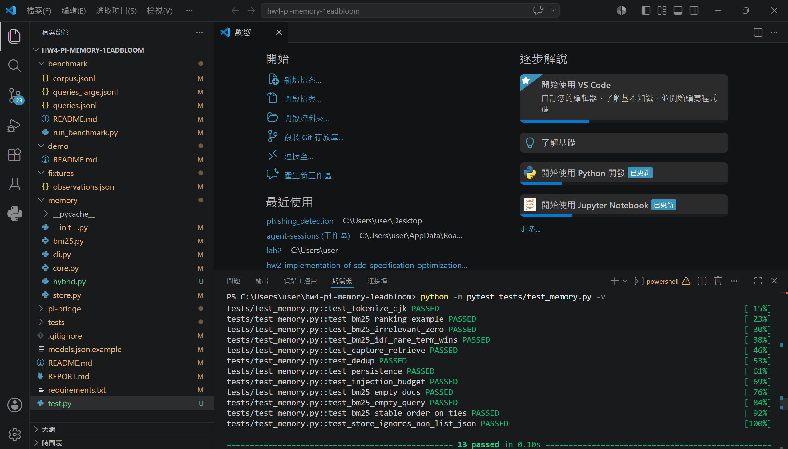
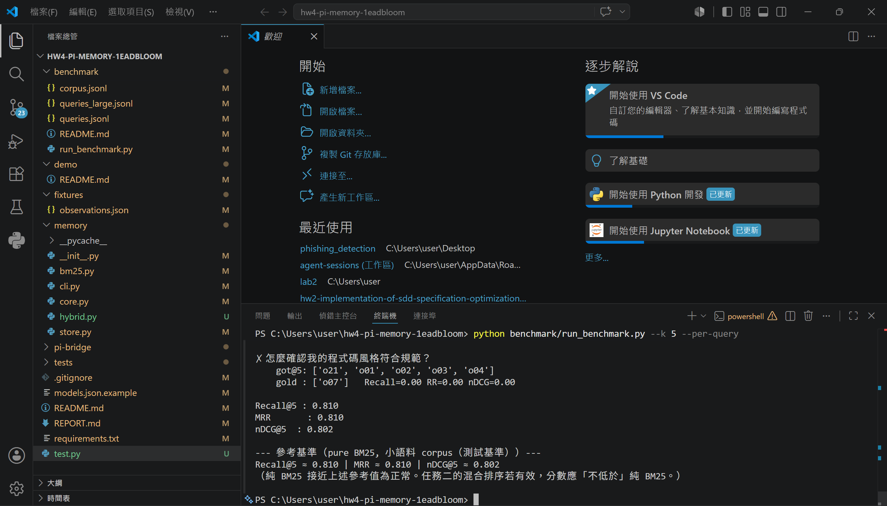

# Demo

展示「跨 session 記憶生效」的完整流程：

1. **Session A**：告訴 agent 一個慣例（「這專案用 pnpm」），agent 呼叫 `remember` 工具將記憶寫入 `~/.pi-memory.json`。
2. 關閉 agent，重開 **Session B**：`before_agent_start` 自動呼叫 `inject`，BM25 搜尋相關記憶並注入 context，agent 直接回答而不再反問。

> **Windows 注意**：extension.ts 中 `import.meta.url.pathname` 在 Windows 會產生 `/C:/...` 格式路徑（多一個前置 `/`），導致 `REPO_ROOT` 解析錯誤，Node.js `spawnSync` 出現假性 ENOENT。
> 由於 extension.ts 不需修改，本機 demo 改以手動預先執行 `python -m memory.cli capture` 寫入記憶，再啟動 pi 驗證 `inject` 路徑正常運作。Python 記憶層（capture / inject）本身功能完整，已於下方截圖驗證。

---

## 截圖

### 1. 輸入記憶（Session A：呼叫 remember，寫入記憶）

### 2. 呼叫記憶（Session B：inject 自動注入，agent 記得了）

### 3. pytest 全綠

### 4. Benchmark 分數

---

## Benchmark 結果

### 純 BM25（`python benchmark/run_benchmark.py --k 5`）

| 指標 | K=5 |
|------|-----|
| Recall@K | 0.810 |
| MRR | 0.810 |
| nDCG@K | 0.802 |

與助教參考基準完全吻合。

### BM25 vs Hybrid 比較（`python benchmark/run_benchmark.py --hybrid --k 5`）

| 指標 | BM25@5 | Hybrid@5 | 提升 |
|------|--------|----------|------|
| Recall@5 | 0.810 | 0.952 | **+14.3pp** |
| MRR | 0.748 | 0.835 | +8.7pp |
| nDCG@5 | 0.755 | 0.864 | +10.9pp |

### 分析

BM25 在 21 題中有 4 題完全找不到（語意距離遠，無共同關鍵字）：

| 失敗的 Query | 正確答案 | 原因 |
|---|---|---|
| how big can an uploaded picture be? | o26（10MB S3 limit） | 「big/picture」和「10MB/S3」無詞彙重疊 |
| when is the team sync meeting each week? | o24（週二早上十點） | 「sync meeting」和「週會/週二」跨語言無重疊 |
| 我要怎麼把新功能慢慢開放給部分使用者？ | o27（LaunchDarkly） | 「慢慢開放」和「feature flags/gradual rollouts」語意差距大 |
| 怎麼確認我的程式碼風格符合規範？ | o07（ruff/black） | 「確認/規範」和「enforced/lint」詞彙不重疊 |

Hybrid（BM25 + multilingual embedding RRF）在 K=5 下救回其中 3 題，Recall 從 81.0% 提升至 95.2%。
唯一仍失敗的是「gradual rollout」（o27）——因為中文 query 和英文 corpus 的語意向量仍有差距，是 cross-lingual retrieval 的已知難點。

